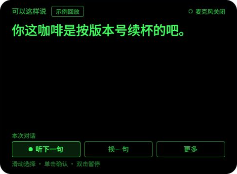
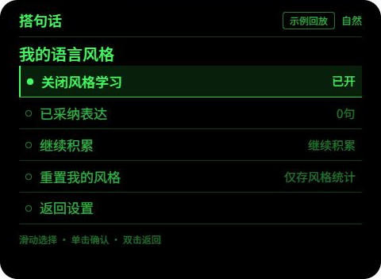

# 搭句话

### 面向智能眼镜的静默中文接话助手

搭句话希望让面对面聊天中的短暂停顿更从容：听完对方一轮发言，结合前面聊过的内容，在眼镜里给出一句可以选择说出口的回应。使用者决定说什么、是否采用，应用默认只显示，不自动代替本人说话。

项目采用 Rokid AIUI，已完成可运行原型、连续对话逻辑与上方扫读界面。当前进入真实语音和眼镜佩戴体验的验证准备阶段。

## 当前完成度 · v0.3.0

- **结合前后聊天**：保留最近8条对话，区分对方和本人；支持补记自己的实际回答，以及确认已经说出口的建议。未采用的候选不会被当成真实对话。
- **更自然的接话**：取消固定夸奖、感谢回复表，根据语境与本轮意愿生成；支持自然、体贴、直接、轻松风格，合适时接梗，严肃话题不强行开玩笑。
- **减少重复等待**：对稳定语音片段提前准备，听完后复用仍然有效的结果；内容发生转折或设置变化时撤销旧候选，完整发言结束后才显示。
- **适应本人表达**：从本人实际回答和明确确认采用的回应中学习句长、提问习惯、口语用词及轻松表达倾向；只保存汇总偏好，可关闭或重置。示例回放、对方发言和未采用建议不进入学习。
- **抬眼扫读布局**：主要回复放在应用显示区域上方，下方留空；支持三档位置、两档字号及完整详情布局。麦克风状态和示例标识始终可见。
- **安静且可控**：可主动听一轮、换一句、选择意愿、暂停或结束。暂停与离页取消采集和生成，结束清空临时聊天；提示20秒后自动收起，可再次展开。

## 界面展示

以下为 **v0.3.0 在官方 Ink 运行时中的实际模拟截图，仅保留应用显示画面**。截图使用明确标记的示例回放，不启用麦克风，不代表现场语音识别、实时模型生成或真实佩戴效果。

| 上方扫读 | 语言风格设置 |
| --- | --- |
|  |  |
| 主提示优先呈现，减少抬眼阅读时的查找；完整原文可在详情布局查看。 | 只学习本人确认的表达，展示积累状态，支持关闭与重新学习。 |

单绿界面以480×352应用画布适配。模拟器中的黑色代表透明显示底；文字对真实背景的可读性与佩戴舒适度需设备验证。

## 目标使用体验

1. **开始听一轮**：由使用者主动开启，听完后确认或等待语音识别结束。
2. **抬眼看一句**：提示结合前文，尽量用简短、自然、符合当前情境的表达。
3. **按自己的想法回应**：邀约、帮忙等涉及决定时，先选择接受、婉拒或暂不决定；不擅自编造理由与承诺。
4. **逐渐贴近本人习惯**：确认实际说出的建议，或复述自己的真实回答，作为后续措辞偏好的依据。
5. **需要时暂停**：停止采集与生成，继续专心聊天；结束后清空本次临时内容。

目前以主动分轮交互为基础。自动区分双方说话人、自然抢话和持续双人聊天仍需真实语音链路验证。

## 开发进展

| 内容 | 当前状态 |
| --- | --- |
| 独立AIUI应用 | 已完成语音与宿主模型接口适配、页面交互及AIX打包 |
| 多轮上下文 | 已实现双方角色记录、前文引用、候选去重及本轮意愿控制 |
| 提前准备与取消 | 已实现有效候选复用、识别修订失效、暂停取消和迟到结果隔离 |
| 本人语言风格 | 已实现本地汇总偏好、证据权重、关闭与重置；属于措辞适配，并非模型训练或人格克隆 |
| 上方提示与位置调整 | 已在官方Ink运行时检查3种位置×2种字号，最长38字可完整显示；保留详情布局 |
| 界面设计与集成 | 前端使用Opus5.5制作，完成逻辑集成和模拟器验证 |
| 真实佩戴与语音 | 待验证收音、说话人归属、显示位置、阅读干扰和端到端等待 |
| 跨次偏好保存 | 已接入官方存储接口并通过适配器测试；桌面预览刷新会重置，真机持久保存待验证 |

2026年10月31日复核：**51项源码自动测试、10个JS源文件检查、7项实际打包后页面测试通过**，AIX完整性检查通过。合成文本已用于检查上下文与风格提示词；这些结果不等于真实对话准确率、秒级响应或佩戴体验验收。

## 显示位置与后续验证

“上方提示”指应用画布内的位置，并不代表已经确认眼镜光学区域相对视线的准确角度。当前支持上方、稍下、居中微调；实际落点、字号与亮度需要结合目标眼镜和佩戴情况校准。当前没有眼动检测或抬头自动触发。

下一阶段重点：验证真实收音与轮次结束、前文理解及语气适配、说完到看到建议的端到端等待、自然交流中的可用性；结合设备检查显示位置、跨次偏好保存、持续使用与耗电。

## 使用与隐私

采集由使用者主动开启，开始前应让对方知情。识别结果和短期上下文交给宿主配置的模型用于生成建议；具体服务行为以目标宿主为准。应用不持久保存原始聊天或音频，语言风格只存汇总统计，显示偏好独立保存。结束本次对话清空临时内容，风格偏好可单独重置。

此仓库用于展示项目进度与交互画面。

---

更新日期：2026 年 10 月 31 日
